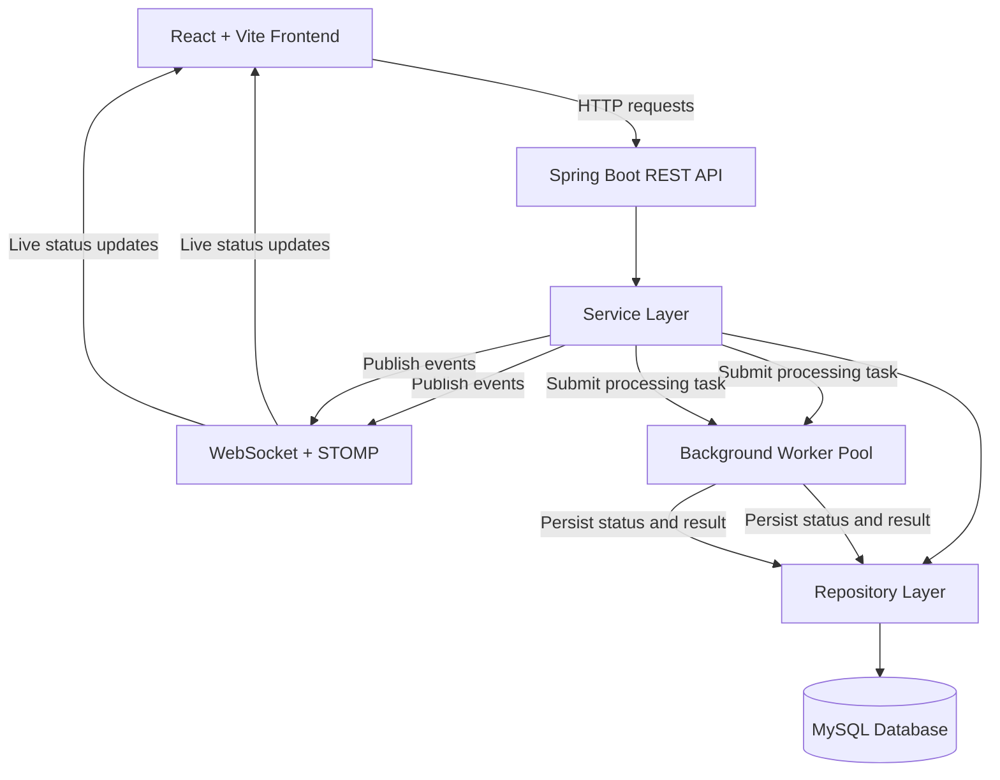
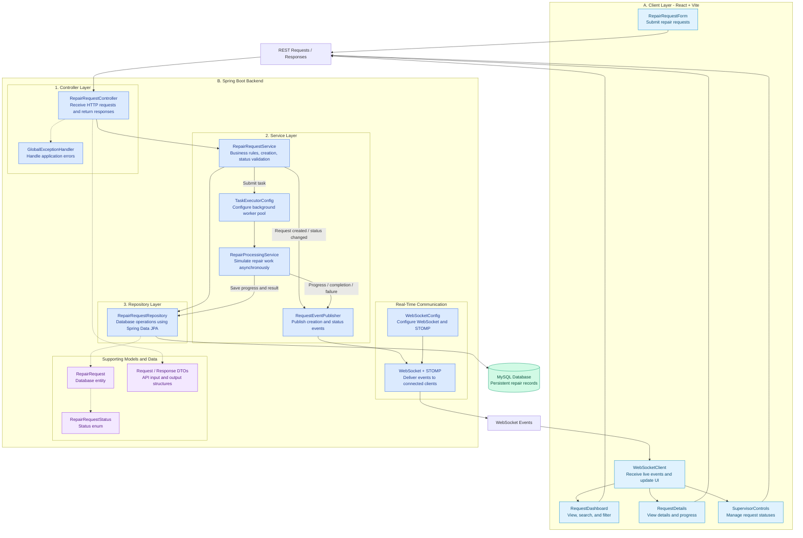
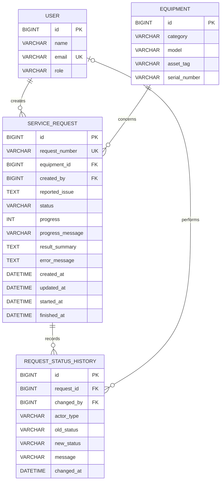
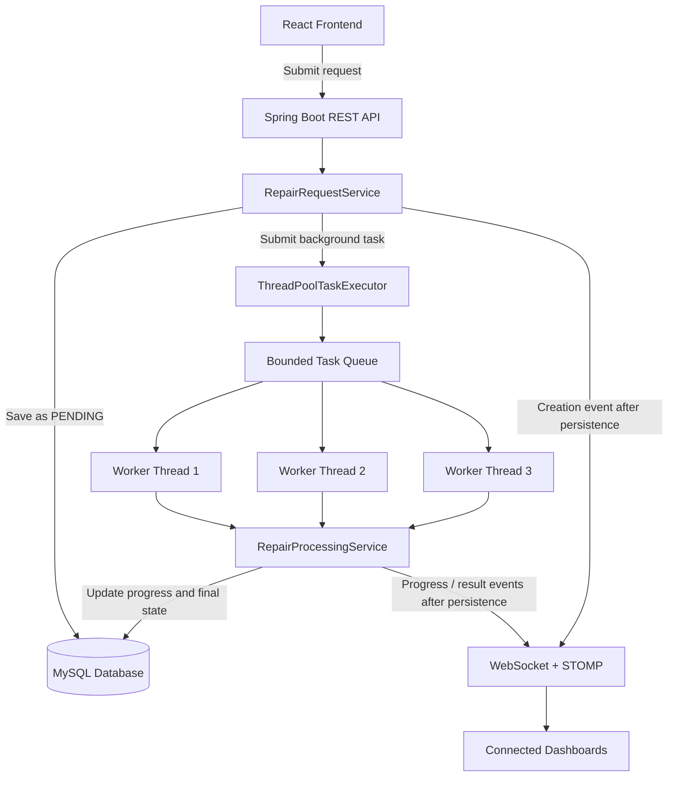
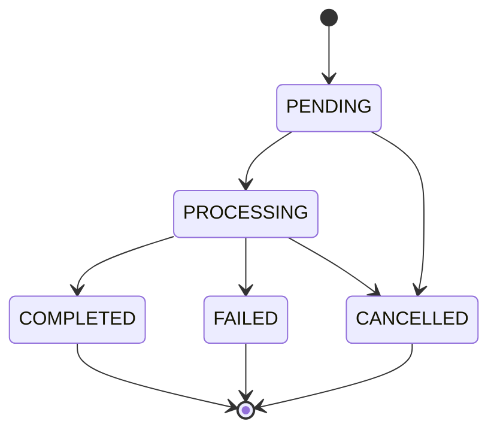

# System Design

## 1. Technology Stack

| Layer | Technology | Purpose |
|---|---|---|
| Frontend | React + Vite | Build a responsive, component-based user interface and provide fast development tooling. |
| Frontend Language | JavaScript | Implement UI behavior, API integration, and frontend state management. |
| Backend | Java 21 + Spring Boot | Implement business logic, REST APIs, validation, and application configuration. |
| REST API | Spring Web | Expose HTTP endpoints for creating, retrieving, searching, and managing repair requests. |
| Database | MySQL | Persist repair requests, equipment information, statuses, timestamps, and processing results. |
| Data Access | Spring Data JPA + Hibernate | Map Java entities to database tables and simplify database operations. |
| Real-Time Communication | Spring WebSocket + STOMP | Push request creation and status-change events to connected frontend clients. |
| Background Processing | Spring ThreadPoolTaskExecutor | Execute multiple simulated repair operations concurrently without blocking incoming API requests. |
| API Testing | Postman | Test REST endpoints, request validation, error handling, and API responses. |
| Version Control | Git + GitHub | Track code changes, maintain meaningful commit history, and host the project repository. |

### Technology Stack Justification

The selected stack uses React for a responsive frontend and Spring Boot for a structured Java backend. MySQL provides persistent relational storage, while Spring Data JPA simplifies database integration.

Spring WebSocket with STOMP supports server-pushed updates to connected clients without relying on polling as the primary update mechanism. Spring's ThreadPoolTaskExecutor provides a configurable worker pool for concurrent background processing.

This stack supports the assignment's mandatory requirements while keeping the application modular and achievable within the assessment deadline. Additional infrastructure such as Redis, Kafka, and microservices is unnecessary for the initial MVP.


## 2. High-Level Architecture

The system consists of a React frontend, a Spring Boot backend, a MySQL database, and a background worker pool. REST APIs handle user actions and data retrieval, WebSocket delivers real-time updates, and background workers simulate repair processing without blocking incoming API requests.



## 3. Backend Component Diagram



## 4. Entity-Relationship Diagram(ERD)


## 5. REST API Design

The system exposes RESTful APIs to create, retrieve, search, and manage IT equipment repair requests. REST APIs handle user actions and initial data retrieval, while WebSocket provides real-time status updates.

### 5.1 API Endpoint Specification

| HTTP Method | Endpoint | Purpose | Request Parameters / Body | Success Response |
|---|---|---|---|---|
| POST | `/api/repair-requests` | Create a new repair request | Equipment category, device model, device identifier (optional), issue description | `201 Created` — created request details |
| GET | `/api/repair-requests` | Retrieve all repair requests | Optional query parameters: `status`, `search`, `from`, `to` | `200 OK` — list of requests |
| GET | `/api/repair-requests/{id}` | Retrieve a specific repair request | Request ID in path | `200 OK` — request details |
| GET | `/api/repair-requests/{id}/history` | Retrieve status transition history | Request ID in path | `200 OK` — list of history records |
| POST | `/api/repair-requests/{id}/cancel` | Cancel a request when its current status allows cancellation | Request ID in path | `200 OK` — updated request details |
| GET | `/api/health` | Check backend availability | None | `200 OK` — health status |

### 5.2 Example Request

**Create a repair request**

`POST /api/repair-requests`

```json
{
  "equipmentCategory": "LAPTOP",
  "deviceModel": "Dell Latitude 5420",
  "deviceIdentifier": "DL-5420-01",
  "issueDescription": "Laptop overheats and shuts down."
}
```

### 5.3 Example Success Response

```json
{
  "id": 1,
  "requestCode": "RR-1001",
  "equipmentCategory": "LAPTOP",
  "deviceModel": "Dell Latitude 5420",
  "deviceIdentifier": "DL-5420-01",
  "issueDescription": "Laptop overheats and shuts down.",
  "status": "PENDING",
  "progressMessage": "Request created and awaiting processing.",
  "resultSummary": null,
  "errorMessage": null,
  "createdAt": "2026-10-29T10:00:00",
  "updatedAt": "2026-10-29T10:00:00",
  "processingStartedAt": null,
  "completedAt": null
}
```

*Note: The values above are illustrative. The backend generates the request ID, unique request code, timestamps, and initial status.*

### 5.4 Error Handling

| HTTP Status | Scenario |
|---|---|
| `400 Bad Request` | Missing required fields, invalid input, or an invalid status transition |
| `404 Not Found` | The requested repair request does not exist |
| `500 Internal Server Error` | Unexpected server-side error |

Errors should use a consistent JSON structure containing the timestamp, HTTP status, message, and request path.


## 6. WebSocket Design and Real-Time Event Flow

### 6.1 Technology and Communication Protocol

The system will use Spring WebSocket with STOMP for real-time communication between the Spring Boot backend and React frontend. STOMP provides a messaging protocol that supports subscriptions to destinations, making it easier to distribute repair-request events to connected clients.

REST APIs will handle initial data retrieval and user actions. WebSocket will deliver subsequent updates without relying on polling as the primary update mechanism.

### 6.2 WebSocket Configuration

| Configuration | Value | Purpose |
|---|---|---|
| WebSocket handshake endpoint | `/ws` | Establish a WebSocket connection |
| Application destination prefix | `/app` | Route client messages to backend message handlers, if needed |
| Broker destination prefix | `/topic` | Deliver published events to subscribers |
| Repair-request event topic | `/topic/repair-requests` | Broadcast repair-request updates to connected clients |

The repair-request topic is a simple broadcast destination for the MVP. Production-grade user-specific access control is outside the initial scope.

### 6.3 Event Types

| Event Type | When It Occurs | Example Information |
|---|---|---|
| `REQUEST_CREATED` | A new request is created | Request ID, request code, current status |
| `STATUS_CHANGED` | A request changes status | Previous status, new status, request ID |
| `PROGRESS_UPDATED` | Processing progress changes | Request ID, progress message |
| `REQUEST_COMPLETED` | Processing finishes successfully | Request ID, result summary |
| `REQUEST_FAILED` | Processing fails | Request ID, error message |
| `REQUEST_CANCELLED` | A request is cancelled | Request ID, current status |

### 6.4 Event Payload

Events will be sent as JSON messages containing an event type, request identifier, current status, message, and timestamp.

Example:

```json
{
  "eventType": "STATUS_CHANGED",
  "requestId": 1,
  "requestCode": "RR-1001",
  "previousStatus": "PENDING",
  "status": "PROCESSING",
  "message": "Repair processing has started.",
  "timestamp": "2026-10-29T10:05:00"
}
```

The values are illustrative. Actual timestamps and request information will be generated by the application.

### 6.5 Real-Time Event Flow

1. The React frontend retrieves the initial request list through the REST API.
2. The frontend establishes a WebSocket connection and subscribes to `/topic/repair-requests`.
3. An operator creates a request, or a background worker updates its processing state.
4. The backend validates the operation and persists the relevant changes to MySQL.
5. After a successful database update, the backend publishes an event to the repair-request topic.
6. Connected frontend clients receive the event and update the relevant dashboard or request details without a page refresh.
7. If a client disconnects or misses an event, it can reconnect and retrieve the latest state through REST.

### 6.6 Reliability Considerations

- Persist state changes before publishing corresponding events.
- Do not treat a WebSocket event as the permanent source of truth; MySQL remains the persistent source of truth.
- Validate status transitions before saving or publishing them.
- Handle WebSocket disconnections and reconnect when appropriate.
- Reload data through REST after reconnection to recover the latest state.
- Do not use periodic polling as the primary real-time update mechanism.


## 7. Concurrency Model

### 7.1 Overview

The IT Equipment Repair Service Request Management System will use **asynchronous background processing with a configurable worker pool** to process multiple repair requests concurrently. Spring's `ThreadPoolTaskExecutor` will manage worker threads, allowing the backend to accept new requests while previously submitted requests are being processed.

The system separates request submission from repair processing:

- **REST API threads** handle incoming HTTP requests, validate input, save initial records, and return responses.
- **Background worker threads** simulate repair processing, update progress, and determine whether each request completes successfully or fails.
- **MySQL** stores the persistent state of each repair request.
- **WebSocket with STOMP** broadcasts persisted status and progress changes to connected frontend clients.

The MVP will use a single Spring Boot application and an in-process worker pool. Distributed queues, Kafka, Redis, and microservices are not required.

### 7.2 Concurrency Architecture



The worker pool enables several requests to be processed at the same time, subject to the configured worker limit. If all workers are busy, additional tasks wait in the queue until a worker becomes available.

### 7.3 Thread Pool Configuration

Spring's `ThreadPoolTaskExecutor` will manage the number of background tasks that can execute simultaneously.

| Configuration | Initial MVP Setting | Purpose |
|---|---:|---|
| Core pool size | 3 threads | Maintain a small pool of background workers |
| Maximum pool size | 3 threads | Limit simultaneous repair simulations |
| Queue capacity | 50 tasks | Temporarily hold tasks waiting for a worker |
| Thread name prefix | `repair-worker-` | Make background activity easier to identify in logs |
| Rejection policy | Explicitly handle rejected tasks | Prevent requests from being silently lost when the executor is full |

These are initial configuration values for development and testing, not universal production limits. They can be adjusted after observing processing duration, resource usage, and expected workload.

**Queue behavior:** The executor processes queued tasks when a worker becomes available. If all worker threads and queue slots are occupied, the system must handle task-submission rejection explicitly. A request must not remain indefinitely in `PENDING` if its task was never accepted.

### 7.4 Request Processing Workflow

1. **Receive request:** The operator submits an equipment repair request through the React interface.
2. **Validate and persist:** The REST API validates the input and saves the request in MySQL with status `PENDING`.
3. **Submit task:** The service submits a background task to the configured executor.
4. **Start processing:** When a worker becomes available, it verifies that the request is still eligible for processing and changes its status to `PROCESSING`.
5. **Simulate repair activity:** The worker executes the simulated repair workflow and periodically updates progress information.
6. **Persist progress:** Each meaningful progress or status update is saved to MySQL.
7. **Publish events:** After a successful database update, the backend publishes the corresponding WebSocket event.
8. **Finish processing:** The worker sets the final status to `COMPLETED`, `FAILED`, or `CANCELLED`, as appropriate, and stores the final result or error information.
9. **Update the interface:** Connected clients receive the event and update the dashboard without requiring a manual page refresh.

The initial REST response should return promptly after the request is persisted and task submission is handled. It must not wait for the complete repair simulation.

### 7.5 Concurrent Processing Example

Suppose three worker threads are available and five repair requests are submitted close together.

| Request | Initial State | Processing Behavior |
|---|---|---|
| RR-1001 | `PENDING` | Worker 1 starts processing |
| RR-1002 | `PENDING` | Worker 2 starts processing |
| RR-1003 | `PENDING` | Worker 3 starts processing |
| RR-1004 | `PENDING` | Waits in the queue |
| RR-1005 | `PENDING` | Waits in the queue |

When Worker 2 finishes processing RR-1002, it becomes available to process RR-1004. RR-1005 can start when another worker becomes available.

The actual order depends on task submission, processing duration, and queue behavior. Concurrent processing does not guarantee that requests will finish in submission order.

### 7.6 Thread Safety and Data Consistency

Multiple worker threads may update different requests simultaneously. The system must also protect against conflicting operations on the same request.

The following rules will be applied:

- **Independent request processing:** Each task operates on a specific repair request and updates only the relevant record.
- **Short database transactions:** Transactions should cover individual database operations, such as changing a status or saving progress, rather than the entire simulated repair process.
- **Valid status transitions:** The service validates the current status before allowing a transition.
- **Optimistic locking or conditional updates:** Use a version field with JPA's `@Version`, or an equivalent conditional database update, to prevent conflicting updates from silently overwriting one another.
- **Cancellation safety:** A queued task must check whether its request has already been cancelled before starting. A running task should periodically check whether cancellation has been requested and stop at a safe point.
- **Duplicate-submission protection:** The worker must not process the same request more than once because of duplicate task submission.
- **Consistent event publication:** Publish WebSocket updates only after the corresponding database transaction has committed successfully.

For example, if a supervisor cancels a request while a worker is about to start it, the system must ensure that the request cannot become `PROCESSING` after it has already been successfully cancelled. This requires coordinated status validation and an atomic or version-protected database update, not just a check in Java code.

### 7.7 Status Lifecycle Under Concurrency

The allowed status transitions are:



The application must validate every transition before saving it. `COMPLETED`, `FAILED`, and `CANCELLED` are terminal states for the MVP; retrying a failed request would require an explicitly designed retry workflow.

### 7.8 Error Handling and Worker Failures

If a simulated repair operation encounters an error, the worker should:

1. Capture and log the exception.
2. Persist the request's `FAILED` status and an appropriate error message.
3. Save the completion timestamp where applicable.
4. Publish a `REQUEST_FAILED` event after the database update commits.
5. Release the worker so it can process another queued task.

If task submission is rejected because the executor is full or unavailable, the service must handle the rejection explicitly and keep the database state consistent. It must not report that processing has started when no worker task was accepted.

### 7.9 System Restart and Concurrency Limitations

The worker pool is in-memory and operates within the Spring Boot process. Therefore, queued tasks are not durable: if the application stops unexpectedly, queued tasks may be lost, and running tasks may be interrupted.

The MVP will persist request states in MySQL so that the application can identify requests left in `PENDING` or `PROCESSING` after a restart. It will not automatically resume interrupted tasks. Recovery and manual handling of those records are part of the documented limitations.

This model provides the concurrency needed for the assignment without introducing distributed processing infrastructure.

### 7.10 Concurrency Acceptance Criteria

The concurrency model will be considered successful when:

- Multiple repair requests can be submitted without waiting for earlier repairs to finish.
- The number of simultaneously running repair tasks does not exceed the configured worker limit.
- Additional tasks wait in the queue when workers are busy.
- The REST API remains responsive during background processing.
- Progress and final statuses are persisted and delivered through WebSocket events.
- Conflicting cancellation and processing operations cannot silently overwrite valid request states.
- Processing failures are recorded without permanently occupying a worker.
- Executor saturation is handled explicitly, and requests are not silently stranded.
- After a restart, interrupted requests can be identified from their persisted statuses.
