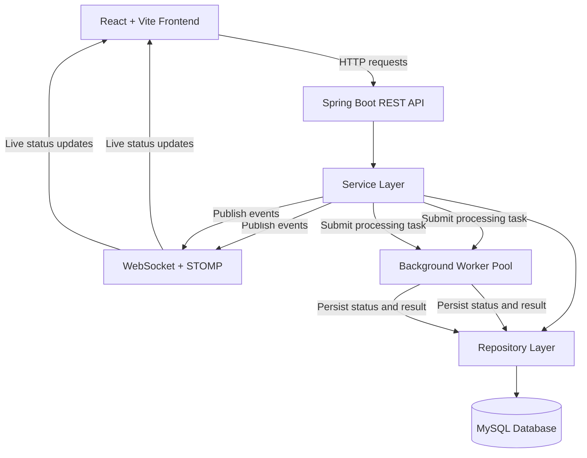
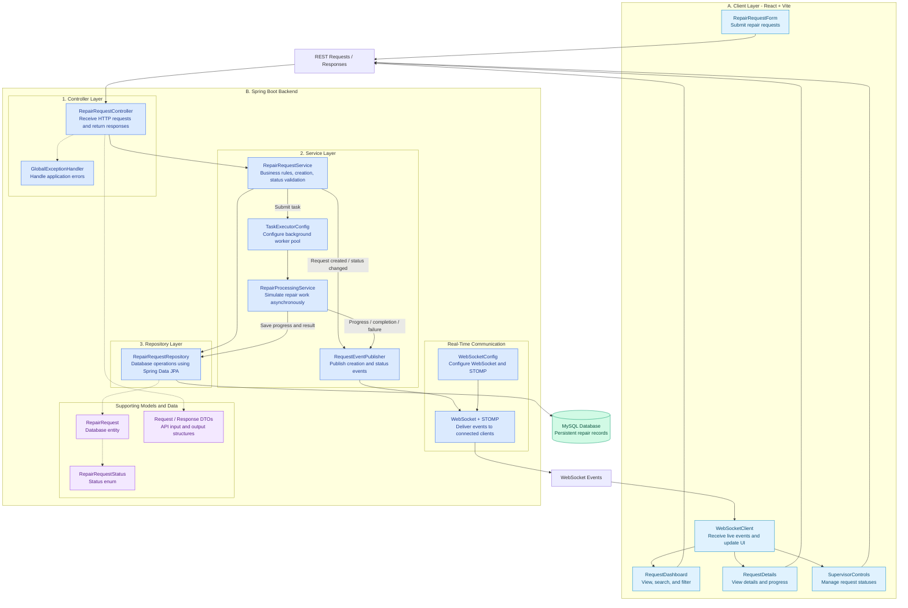
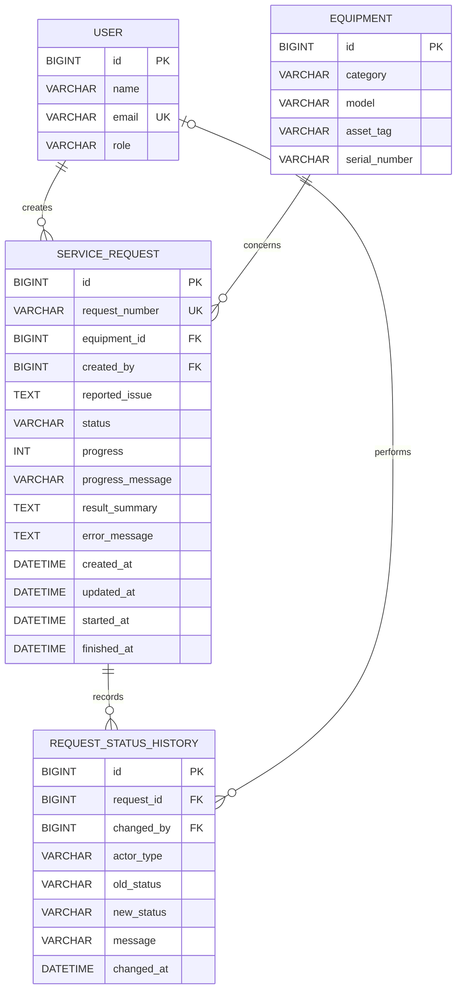

# System Design

## 1. Technology Stack

| Layer | Technology | Purpose |
|---|---|---|
| Frontend | React + Vite | Build a responsive, component-based user interface and provide fast development tooling. |
| Frontend Language | JavaScript | Implement UI behavior, API integration, and frontend state management. |
| Backend | Java 21 + Spring Boot | Implement business logic, REST APIs, validation, and application configuration. |
| REST API | Spring Web | Expose HTTP endpoints for creating, retrieving, searching, and managing repair requests. |
| Database | MySQL | Persist repair requests, equipment information, statuses, timestamps, and processing results. |
| Data Access | Spring Data JPA + Hibernate | Map Java entities to database tables and simplify database operations. |
| Real-Time Communication | Spring WebSocket + STOMP | Push request creation and status-change events to connected frontend clients. |
| Background Processing | Spring ThreadPoolTaskExecutor | Execute multiple simulated repair operations concurrently without blocking incoming API requests. |
| API Testing | Postman | Test REST endpoints, request validation, error handling, and API responses. |
| Version Control | Git + GitHub | Track code changes, maintain meaningful commit history, and host the project repository. |

### Technology Stack Justification

The selected stack uses React for a responsive frontend and Spring Boot for a structured Java backend. MySQL provides persistent relational storage, while Spring Data JPA simplifies database integration.

Spring WebSocket with STOMP supports server-pushed updates to connected clients without relying on polling as the primary update mechanism. Spring's ThreadPoolTaskExecutor provides a configurable worker pool for concurrent background processing.

This stack supports the assignment's mandatory requirements while keeping the application modular and achievable within the assessment deadline. Additional infrastructure such as Redis, Kafka, and microservices is unnecessary for the initial MVP.


## 2. High-Level Architecture

The system consists of a React frontend, a Spring Boot backend, a MySQL database, and a background worker pool. REST APIs handle user actions and data retrieval, WebSocket delivers real-time updates, and background workers simulate repair processing without blocking incoming API requests.



## 3. Backend Component Diagram



## 4. Entity-Relationship Diagram(ERD)


## 5. REST API Design

The system exposes RESTful APIs to create, retrieve, search, and manage IT equipment repair requests. REST APIs handle user actions and initial data retrieval, while WebSocket provides real-time status updates.

### 5.1 API Endpoint Specification

| HTTP Method | Endpoint | Purpose | Request Parameters / Body | Success Response |
|---|---|---|---|---|
| POST | `/api/repair-requests` | Create a new repair request | Equipment category, device model, device identifier (optional), issue description | `201 Created` — created request details |
| GET | `/api/repair-requests` | Retrieve all repair requests | Optional query parameters: `status`, `search`, `from`, `to` | `200 OK` — list of requests |
| GET | `/api/repair-requests/{id}` | Retrieve a specific repair request | Request ID in path | `200 OK` — request details |
| GET | `/api/repair-requests/{id}/history` | Retrieve status transition history | Request ID in path | `200 OK` — list of history records |
| POST | `/api/repair-requests/{id}/cancel` | Cancel a request when its current status allows cancellation | Request ID in path | `200 OK` — updated request details |
| GET | `/api/health` | Check backend availability | None | `200 OK` — health status |

### 5.2 Example Request

**Create a repair request**

`POST /api/repair-requests`

```json
{
  "equipmentCategory": "LAPTOP",
  "deviceModel": "Dell Latitude 5420",
  "deviceIdentifier": "DL-5420-01",
  "issueDescription": "Laptop overheats and shuts down."
}
```

### 5.3 Example Success Response

```json
{
  "id": 1,
  "requestCode": "RR-1001",
  "equipmentCategory": "LAPTOP",
  "deviceModel": "Dell Latitude 5420",
  "deviceIdentifier": "DL-5420-01",
  "issueDescription": "Laptop overheats and shuts down.",
  "status": "PENDING",
  "progressMessage": "Request created and awaiting processing.",
  "resultSummary": null,
  "errorMessage": null,
  "createdAt": "2026-10-29T10:00:00",
  "updatedAt": "2026-10-29T10:00:00",
  "processingStartedAt": null,
  "completedAt": null
}
```

*Note: The values above are illustrative. The backend generates the request ID, unique request code, timestamps, and initial status.*

### 5.4 Error Handling

| HTTP Status | Scenario |
|---|---|
| `400 Bad Request` | Missing required fields, invalid input, or an invalid status transition |
| `404 Not Found` | The requested repair request does not exist |
| `500 Internal Server Error` | Unexpected server-side error |

Errors should use a consistent JSON structure containing the timestamp, HTTP status, message, and request path.


