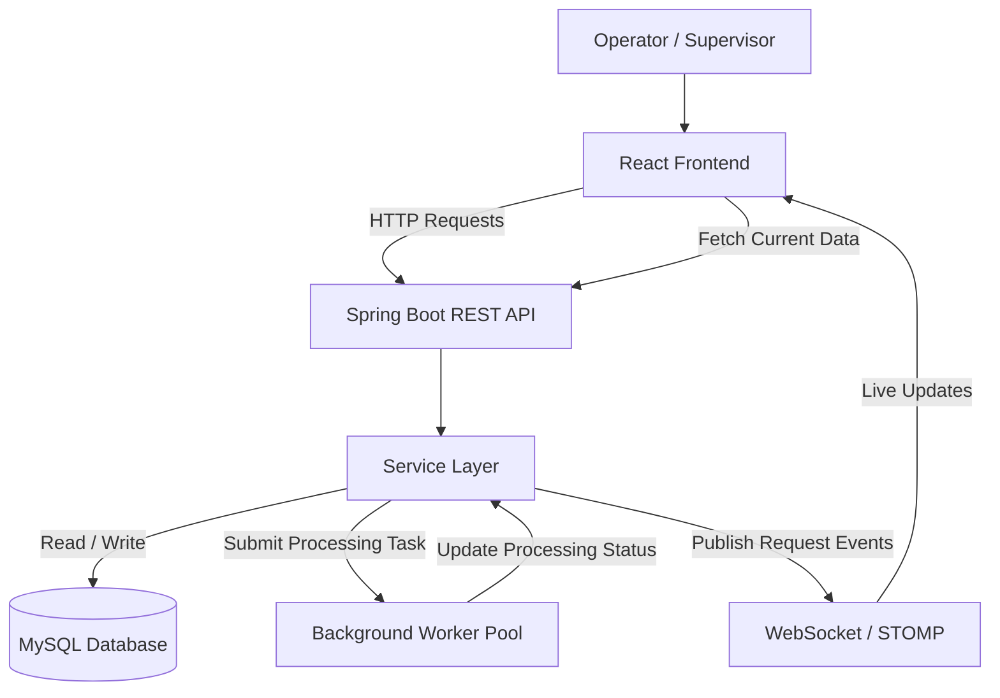

# System Design

## 1. Technology Stack

**1. Frontend:** React + Vite

**2. Programming Language:** JavaScript

**3. Backend:** Java 21 + Spring Boot

**4. REST API:** Spring Web

**5. Real-Time Communication:** Spring WebSocket + STOMP

**6. Database:** MySQL + Spring Data JPA

**7. Background Processing:** Java Executor / Spring `@Async`

**8. Version Control:** Git + GitHub


## 2. High-Level Architecture

The system will follow a layered client-server architecture consisting of a React frontend, a Spring Boot backend, a MySQL database, a background processing component, and a WebSocket communication channel.

### 2.1 Architecture Overview

1. **Frontend:** Operators submit service requests and view their request information. Supervisors monitor all requests and their processing status through a responsive dashboard.
2. **REST API:** The React frontend communicates with the Spring Boot backend through REST APIs to create, retrieve, update, and cancel service requests.
3. **Backend Business Logic:** The Spring Boot service layer validates requests, applies business rules, manages status transitions, and coordinates database operations.
4. **Database:** MySQL stores service request information and processing status so that records remain available after page refreshes or application restarts.
5. **Background Processing:** Long-running request operations execute through background workers, allowing the backend to continue accepting incoming API requests while other operations are processing.
6. **WebSocket Communication:** The backend publishes request creation, status changes, and processing updates through WebSockets. Connected frontend clients receive these events and update their interfaces without manual page refreshes.

### 2.2 High-Level Architecture Diagram



### 2.3 Architecture Design Principles

- **Separation of Concerns:** The frontend, REST controllers, business logic, data access, and background processing will have separate responsibilities.
- **Persistent Data:** Request information and status changes will be stored in MySQL rather than maintained only in frontend memory.
- **Asynchronous Processing:** Long-running operations will execute in the background to keep API request handling responsive.
- **Real-Time Updates:** WebSocket events will notify connected clients when relevant request information changes. Polling will not be used as the primary update mechanism.
- **Maintainability:** The application will use a modular structure that makes its components easier to test, debug, and extend.


## 3. Component Design

The system is divided into the following components:

**1. Frontend (React + Vite):**
Provides the user interface for creating service requests, viewing request details, searching and filtering requests, and monitoring real-time status and progress.

**2. REST Controller:**
Receives HTTP requests from the frontend, validates incoming data, and returns appropriate HTTP responses.

**3. Service Layer:**
Contains the business logic for creating requests, managing request status, cancelling eligible requests, and coordinating background processing.

**4. Repository Layer:**
Uses Spring Data JPA to communicate with the MySQL database and perform CRUD operations on service requests.

**5. Background Processing Component:**
Executes long-running service request operations asynchronously so that API requests remain responsive.

**6. WebSocket Component:**
Uses Spring WebSocket and STOMP to broadcast request status and progress updates to connected clients.

**7. MySQL Database:**
Permanently stores service request information, statuses, timestamps, progress, and processing results or errors.

---

## 4. Database Design

The system uses MySQL as its persistent database.

### Service Request Table

| Field | Data Type | Description |
|---|---|---|
| id | BIGINT | Primary key; uniquely identifies each request |
| title | VARCHAR(150) | Short title of the service request |
| description | TEXT | Detailed description of the request |
| status | VARCHAR(20) | Current status: PENDING, PROCESSING, COMPLETED, FAILED, or CANCELLED |
| progress | INT | Processing progress from 0 to 100 |
| result | TEXT | Processing result, when available |
| error_message | TEXT | Error details, when processing fails |
| created_at | DATETIME | Date and time the request was created |
| updated_at | DATETIME | Date and time the request was last updated |
| started_at | DATETIME | Date and time processing started |
| completed_at | DATETIME | Date and time processing ended, when applicable |

### Relationships and Constraints

- The `id` field is the primary key and uniquely identifies each request.
- The `status` field must contain one of the permitted lifecycle states.
- The `progress` field must remain between 0 and 100.
- New requests start with the `PENDING` status and 0% progress.
- A successful request ends with `COMPLETED` and 100% progress.
- A failed request ends with `FAILED`, with relevant error information recorded.
- A cancelled request ends with `CANCELLED` when cancellation is permitted.

**Assumption:** For the initial MVP, user accounts and authentication are not included in the core database design. Role-based access can be added as an extension if time permits.

---

## 5. REST API Design

The system exposes REST APIs to create, retrieve, search, and manage service requests.

| Method | Endpoint | Purpose |
|---|---|---|
| POST | `/api/requests` | Create a new service request |
| GET | `/api/requests` | Retrieve requests with optional filters |
| GET | `/api/requests/{id}` | Retrieve details of a specific request |
| PATCH | `/api/requests/{id}/cancel` | Cancel a request when eligible |

### Request Creation

**Endpoint:** `POST /api/requests`

Example request body:

```json
{
  "title": "Generate Monthly Report",
  "description": "Generate a report from the available records."
}
