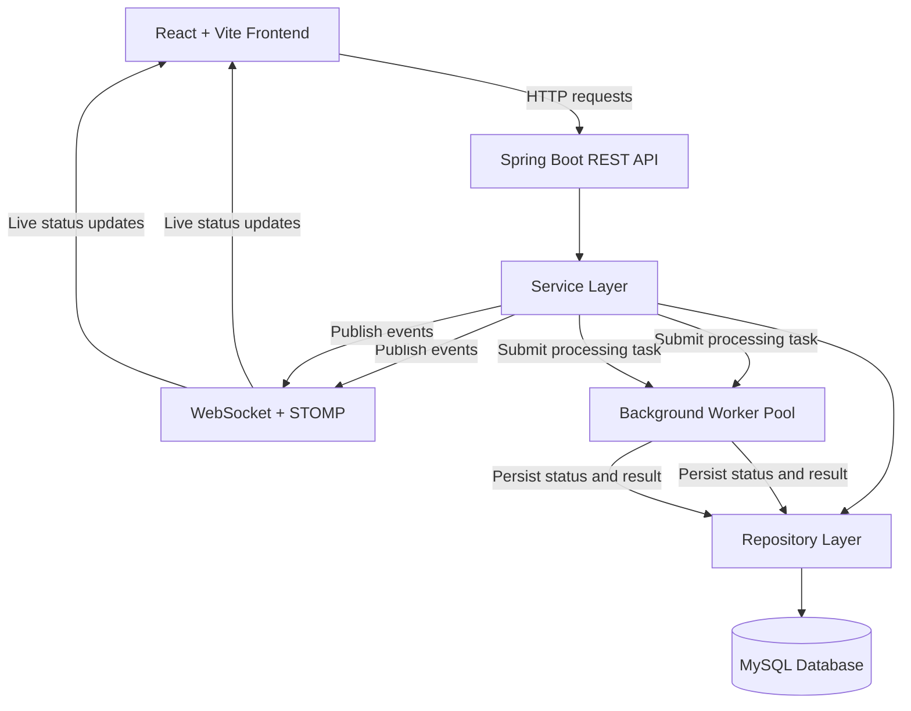
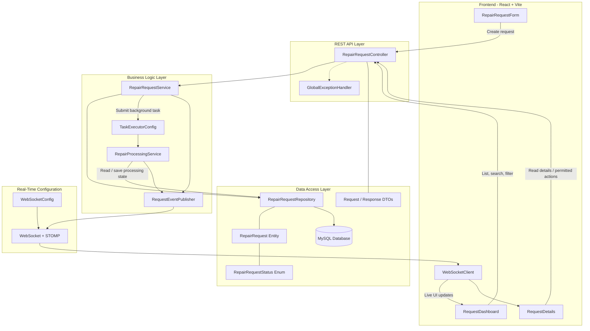

# System Design

## 1. Technology Stack

| Layer | Technology | Purpose |
|---|---|---|
| Frontend | React + Vite | Build a responsive, component-based user interface and provide fast development tooling. |
| Frontend Language | JavaScript | Implement UI behavior, API integration, and frontend state management. |
| Backend | Java 21 + Spring Boot | Implement business logic, REST APIs, validation, and application configuration. |
| REST API | Spring Web | Expose HTTP endpoints for creating, retrieving, searching, and managing repair requests. |
| Database | MySQL | Persist repair requests, equipment information, statuses, timestamps, and processing results. |
| Data Access | Spring Data JPA + Hibernate | Map Java entities to database tables and simplify database operations. |
| Real-Time Communication | Spring WebSocket + STOMP | Push request creation and status-change events to connected frontend clients. |
| Background Processing | Spring ThreadPoolTaskExecutor | Execute multiple simulated repair operations concurrently without blocking incoming API requests. |
| API Testing | Postman | Test REST endpoints, request validation, error handling, and API responses. |
| Version Control | Git + GitHub | Track code changes, maintain meaningful commit history, and host the project repository. |

### Technology Stack Justification

The selected stack uses React for a responsive frontend and Spring Boot for a structured Java backend. MySQL provides persistent relational storage, while Spring Data JPA simplifies database integration.

Spring WebSocket with STOMP supports server-pushed updates to connected clients without relying on polling as the primary update mechanism. Spring's ThreadPoolTaskExecutor provides a configurable worker pool for concurrent background processing.

This stack supports the assignment's mandatory requirements while keeping the application modular and achievable within the assessment deadline. Additional infrastructure such as Redis, Kafka, and microservices is unnecessary for the initial MVP.

## 2. High-Level Architecture

The system consists of a React frontend, a Spring Boot backend, a MySQL database, and a background worker pool. REST APIs handle user actions and data retrieval, WebSocket delivers real-time updates, and background workers simulate repair processing without blocking incoming API requests.

## 3. Backend Component Diagram

