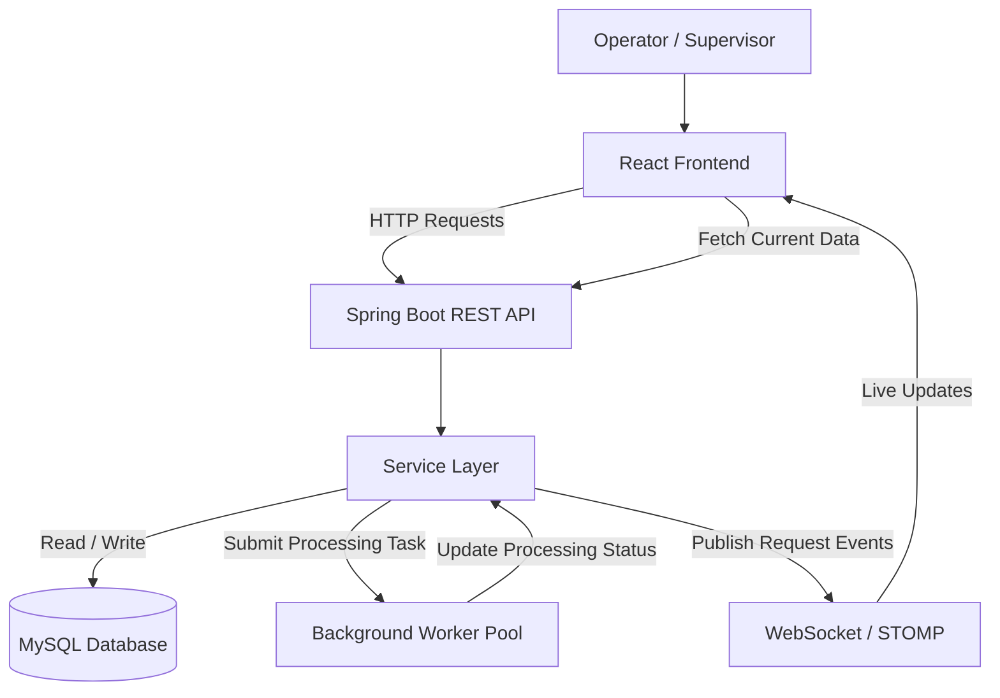

# System Design

## 1. Technology Stack

**1. Frontend:** React + Vite

**2. Programming Language:** JavaScript

**3. Backend:** Java 21 + Spring Boot

**4. REST API:** Spring Web

**5. Real-Time Communication:** Spring WebSocket + STOMP

**6. Database:** MySQL + Spring Data JPA

**7. Background Processing:** Java Executor / Spring `@Async`

**8. Version Control:** Git + GitHub

## 2. High-Level Architecture

The system will follow a layered client-server architecture consisting of a React frontend, a Spring Boot backend, a MySQL database, a background processing component, and a WebSocket communication channel.

### 2.1 Architecture Overview

1. **Frontend:** Operators submit service requests and view their request information. Supervisors monitor all requests and their processing status through a responsive dashboard.
2. **REST API:** The React frontend communicates with the Spring Boot backend through REST APIs to create, retrieve, update, and cancel service requests.
3. **Backend Business Logic:** The Spring Boot service layer validates requests, applies business rules, manages status transitions, and coordinates database operations.
4. **Database:** MySQL stores service request information and processing status so that records remain available after page refreshes or application restarts.
5. **Background Processing:** Long-running request operations execute through background workers, allowing the backend to continue accepting incoming API requests while other operations are processing.
6. **WebSocket Communication:** The backend publishes request creation, status changes, and processing updates through WebSockets. Connected frontend clients receive these events and update their interfaces without manual page refreshes.

### 2.2 High-Level Architecture Diagram

### 2.3 Architecture Design Principles

- **Separation of Concerns:** The frontend, REST controllers, business logic, data access, and background processing will have separate responsibilities.
- **Persistent Data:** Request information and status changes will be stored in MySQL rather than maintained only in frontend memory.
- **Asynchronous Processing:** Long-running operations will execute in the background to keep API request handling responsive.
- **Real-Time Updates:** WebSocket events will notify connected clients when relevant request information changes. Polling will not be used as the primary update mechanism.
- **Maintainability:** The application will use a modular structure that makes its components easier to test, debug, and extend.
